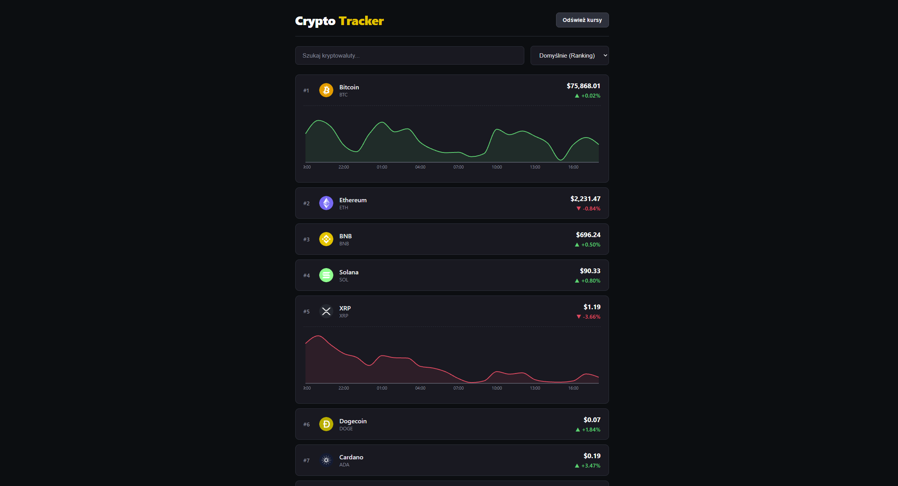

# Crypto Tracker

Tablica do śledzenia kursów kryptowalut w czasie rzeczywistym zintegrowany z publicznym API giełdy Binance.



## Główne funkcje

- **Kursy na żywo z Binance API**: Aktualne ceny, 24-godzinna zmiana procentowa.
- **Interaktywne wykresy 24h**: Po kliknięciu w dowolną monetę rozwija się wykres cenowy z ostatnich 24 godzin.
- **Auto-odświeżanie**: Automatyczne pobieranie najświeższych cen w tle co 15 sekund.
- **Wyszukiwarka na żywo**: Natychmiastowe filtrowanie monet po nazwie lub symbolu (np. BTC, Solana).
- **Sortowanie**: Możliwość sortowania po rankingu, najwyższej cenie, największych wzrostach oraz spadkach.

## Użyte technologie

- **React 19**
- **Vite**
- **Recharts**
- **Binance API**

## Uruchomienie

1. Sklonuj repozytorium:
   ```bash
   git clone https://github.com/JakubDolas/crypto-tracker.git
   ```
2. Wejdź do folderu z projektem:
   ```bash
   cd crypto-tracker
   ```
3. Zainstaluj zależności:
   ```bash
   npm install
   ```
4. Uruchom serwer deweloperski:
   ```bash
   npm run dev
   ```
5. Otwórz w przeglądarce podany w terminalu adres (zwykle `http://localhost:5173`).